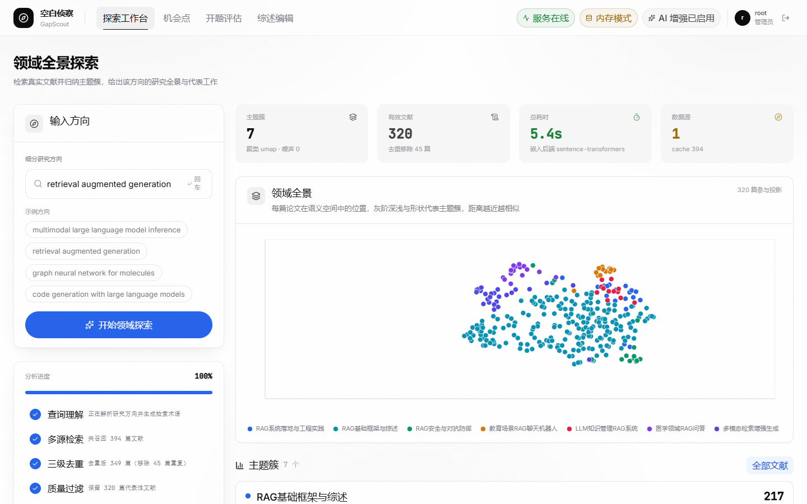
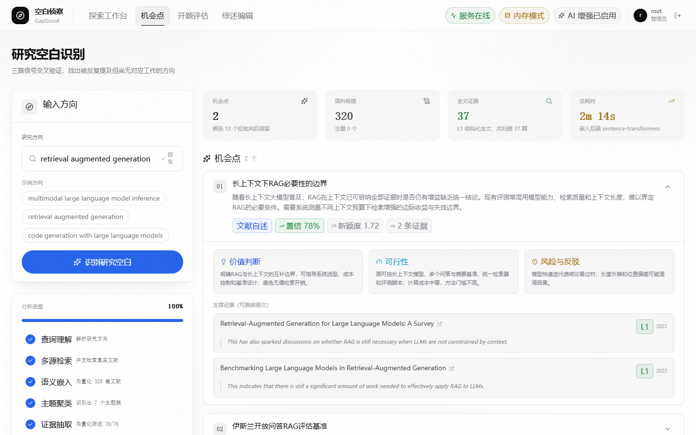
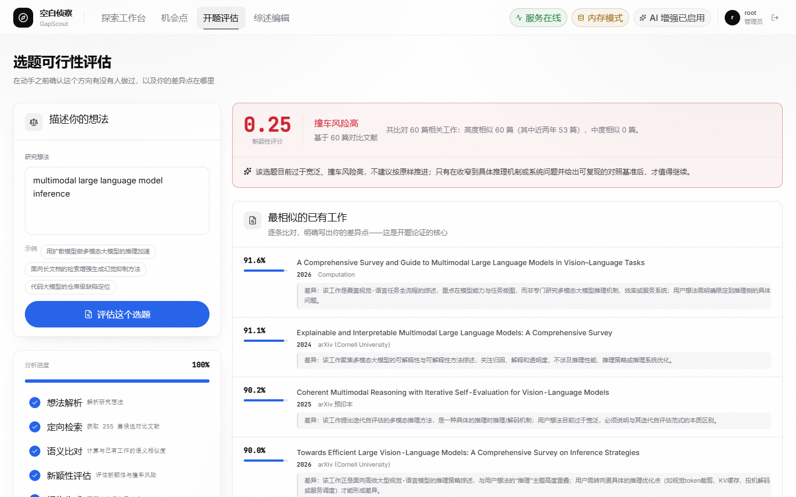
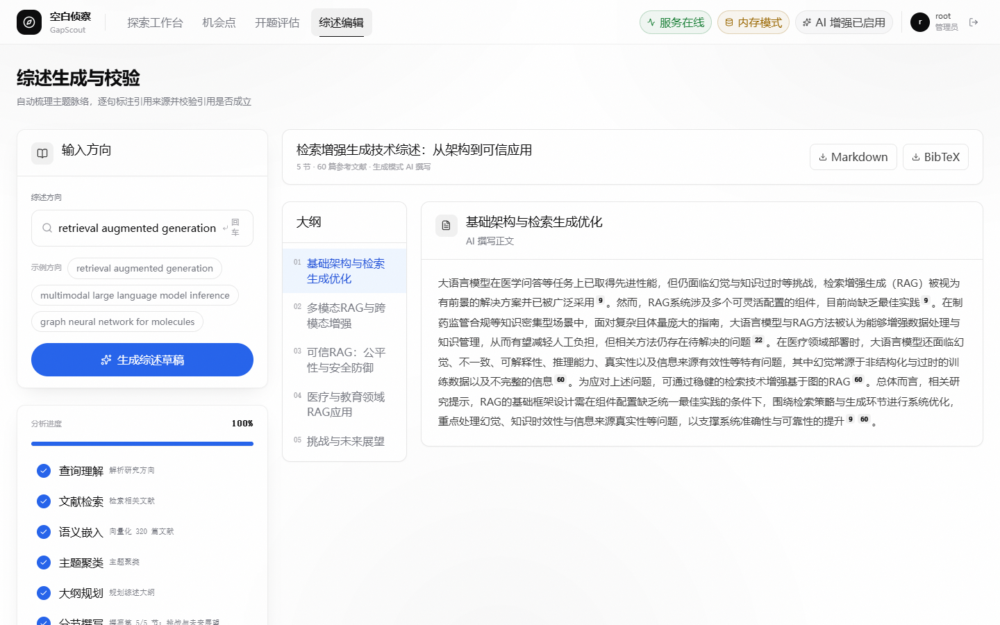
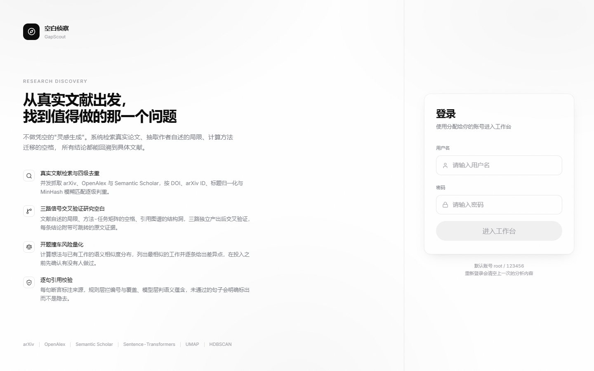
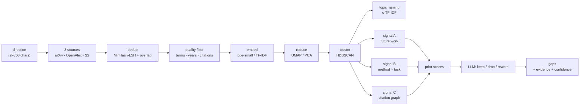

<p align="center">
  
</p>

<h1 align="center">GapScout · 空白侦察</h1>

<p align="center">
  <b>Compute research gaps from real literature — not from a language model's imagination.</b>
</p>

<p align="center">
  <a href="https://github.com/loveBatman/gapscout/actions/workflows/ci.yml"></a>
  <a href="LICENSE"></a>
  
  
  
  
</p>

<p align="center">
  <a href="#quickstart"><b>Quickstart</b></a> ·
  <a href="#how-it-works">How it works</a> ·
  <a href="#api">API</a> ·
  <a href="#known-limitations">Limitations</a> ·
  <a href="README.zh-CN.md">简体中文</a>
</p>

<p align="center">
  
</p>

- **Computed, not hallucinated.** Three independent signals must agree before a gap is reported. The LLM only keeps or drops a candidate — it cannot invent one.
- **Every citation is checked.** A whitelist, then a coverage check, then per-sentence entailment. When verification cannot run, the output says `unverified` instead of pretending otherwise.
- **Runs on a laptop, degrades honestly.** No database, no API key, no GPU. Each fallback is reported in the response, never applied silently.

---

## Gaps are computed, not guessed

Ask a chat model where the research gaps are and you get a fluent answer with no evidence: it has no corpus in front of it, so it reconstructs plausible-sounding omissions from memory. The failure mode is invisible — the prose is confident either way.

GapScout inverts the order. It retrieves a real corpus first, then runs three **independent** signals over it:

| Signal | What it measures | Why it is not just "keywords I did not see" |
| --- | --- | --- |
| **A · Future-work aggregation** | Explicit limitations and "future work" statements across papers, plus centroid coverage — a region of the embedding space that is thin despite being surrounded by dense clusters | Grounded in what authors themselves wrote, weighted by evidence quality, not by absence of text |
| **B · Method × task matrix** | A 20 × 15 matrix of method families against task types, built over 6 modality dimensions; a cell with active neighbours but no papers of its own is a structural hole | Two axes, so an empty cell is a *combination* nobody published, not a missing word |
| **C · Citation graph** | Structural holes, rising clusters, and candidate turning points in the reference graph | Uses how papers cite each other, which text similarity cannot see |

Each signal produces a prior score, and the three are surfaced separately rather than blended into one opaque number:

```
A:  paper_count × evidence_weight × (0.5 + gap_strength)
B:  log1p(neighbour_activity) × 1.6
C:  log1p(turning_point_potential) × 1.1
```

Only after that does the LLM see the candidates. Its job is three verbs — **keep, drop, reword**. It is given the evidence and the prior scores, and it cannot add a gap the signals did not produce. Every reported gap carries the paper IDs it came from.

This is the difference between *generating* a gap and *locating* one.

---

## What you get

Four steps, each an independent page in the app:

**1 · Panorama** — Retrieve from three sources, deduplicate, filter, embed, cluster, and name the topics. You get a 2-D map of the field, a topic list with representative papers, and a scatter you can actually read.

**2 · Gap discovery** — Run the three signals above, surface candidates, then critically filter them. Candidates that survive keep their evidence, a confidence value, and a novelty score.

**3 · Feasibility** — Describe an idea in plain language. It is embedded, compared against the corpus, and scored for novelty and collision risk, with the closest existing work listed side by side.

**4 · Review** — Generate a sectioned survey over the retrieved corpus. Every sentence is checked against the citation whitelist; sentences that cannot be supported are flagged rather than smoothed over. Markdown and BibTeX export.

---

## Measured, not claimed

The following are measurements taken during development, kept because they explain design decisions rather than to advertise speed. Reproduce them with `scripts/profile_run.py` on your own corpus.

| Observation | Measurement | What it changed |
| --- | --- | --- |
| First UMAP call on a 281-paper corpus | 22.7 s wall clock, of which 1.01 s was the actual reduction | The reducer is created once and reused; the rest is one-time JIT compilation, not per-run cost |
| Running HDBSCAN on raw embeddings | 132 of 163 papers classified as noise, 1 topic found | Dimensionality reduction is mandatory, not optional — without it clustering collapses |
| Embedding model re-initialised per stage | 10.1 s per re-init | The model is cached process-wide |
| Chinese full-sentence query against OpenAlex | 1 paper returned, versus keyword-shaped query | Queries are reshaped before dispatch, not passed through verbatim |
| `bge-small` cosine similarity | relevant pairs 0.62–0.70, weak pairs 0.45–0.55 | Dedup threshold set at 0.78 with an overlap term, not at the similarity boundary |
| One LLM critique pass | 24.7–48.1 s, i.e. 33–40 % of the gap pipeline | This is the single largest cost; it is a batched, bounded call rather than per-candidate |

There is no benchmark table here comparing this against commercial products. A credible comparison would need a shared task and a labelled answer key; the repo does not ship one, so any such table would be marketing.

---

## In the app

| Gap discovery | Feasibility check |
| --- | --- |
|  |  |

| Review | Entry point |
| --- | --- |
|  |  |

---

## How it works



**Deduplication** uses MinHash-LSH with 3-shingles, a 0.78 similarity threshold and 64 permutations, so roughly 4 × 10⁶ naive pairwise comparisons collapse to a near-linear candidate set. A similarity term alone over-merges papers in the same subfield, so exact term overlap is required as a second condition.

**Clustering** uses two separate projections on purpose: a 5-dimensional reduction for HDBSCAN, and a 2-dimensional one for display. Using the display projection for clustering produces the noise explosion in the table above.

**Progress** is pushed over SSE. The task bus keeps one queue per task with a 15-second heartbeat, replays current state on reconnect, and needs no Redis — which matters because the app is meant to run without external services.

---

## Quickstart

Requires **Python 3.11+** and **Node 18+**. No database, no GPU and no API key is strictly required to explore the pipeline.

```bash
git clone https://github.com/loveBatman/gapscout.git
cd gapscout
```

**1 · Backend**

```bash
cd backend
python -m venv .venv
source .venv/bin/activate        # macOS / Linux
# .venv\Scripts\activate         # Windows

pip install -e ".[embed,cluster]"
cp .env.example .env             # then set DEEPSEEK_API_KEY in .env
uvicorn app.main:app --reload --port 8001
```

`.[embed,cluster]` pulls in `sentence-transformers` and `umap-learn`. Without them the app still starts and silently falls back to TF-IDF and PCA — results will differ, so install them if you want the intended behaviour.

**2 · Frontend** (new terminal)

```bash
cd frontend
npm install
npm run dev
```

Open <http://localhost:5173>. The demo gate accepts **`root` / `123456`** — see [Known limitations](#known-limitations) before deploying this anywhere.

**3 · Optional database**

```bash
docker compose up -d            # pgvector on port 5433
```

Postgres is **not** on the critical path. With it, results are persisted per task; without it, the same results are written to a local JSON snapshot. `/api/v1/health` reports which mode you are in.

### Verify the install

```bash
curl http://localhost:8001/api/v1/health
# {"status":"ok","app":"空白侦察 GapScout","version":"0.1.0",
#  "database":"down","llm_configured":true}
```

`database: "down"` and `llm_configured: false` are both valid, working states — they tell you which fallbacks are active, not that something broke.

### Behind a restricted network?

The embedding model is fetched from Hugging Face on first run. If that endpoint is not reachable from your network, point `HF_ENDPOINT` at a mirror in `.env` (for example `https://hf-mirror.com`) and restart the backend.

---

## Configuration

Every setting has a working default. These are the ones worth knowing; the rest are documented inline in `backend/.env.example`.

| Variable | Default | Notes |
| --- | --- | --- |
| `DEEPSEEK_API_KEY` | *(empty)* | Empty means pure-rule mode: no critique, no polished topic names |
| `DEEPSEEK_BASE_URL` | `https://api.deepseek.com/v1` | Any OpenAI-compatible endpoint works |
| `LLM_MODEL_MAIN` | `deepseek-reasoner` | Used only for the critique pass |
| `LLM_MODEL_CHEAP` | `deepseek-chat` | Topic naming, query shaping |
| `EMBED_MODEL` | `BAAI/bge-small-en-v1.5` | Changing the model also requires changing `EMBED_DIM` in `app/config.py` |
| `CONTACT_EMAIL` | `your_email@example.com` | Sent in the User-Agent; arXiv and OpenAlex give polite-pool rate limits to identified clients |
| `DATABASE_URL` | `postgresql+asyncpg://…:5433/gapscout` | Matches `docker-compose.yml`; optional |

---

## API

All endpoints are under `/api/v1`. Long-running work is asynchronous: the POST returns a task id, and progress streams from the task endpoint.

| Method | Path | Body | Purpose |
| --- | --- | --- | --- |
| `POST` | `/explore` | `{"direction": "…", "year_from": 2019, "min_citations": 0}` | Topic panorama |
| `POST` | `/gaps` | `{"direction": "…"}` | Gap discovery |
| `POST` | `/feasibility` | `{"idea": "…"}` | Novelty and collision risk |
| `POST` | `/review` | `{"direction": "…"}` | Sectioned survey |
| `GET` | `/tasks?limit=20` | — | Recent tasks |
| `GET` | `/tasks/{task_id}` | — | Full result of one task |
| `GET` | `/tasks/{task_id}/stream` | — | SSE progress, 15 s heartbeat |
| `GET` | `/health` | — | Status and active fallbacks |

```bash
curl -X POST http://localhost:8001/api/v1/gaps \
  -H 'Content-Type: application/json' \
  -d '{"direction": "efficient fine-tuning for long-context retrieval"}'
# {"task_id":"…","status":"pending"}

curl -N http://localhost:8001/api/v1/tasks/<task_id>/stream
```

---

## Graceful degradation

There are five independent axes. Every one has a fallback, and every fallback is reported rather than hidden — which is why `health` can show `database: "down"` as a normal value.

| Axis | If missing | Fallback | How to tell |
| --- | --- | --- | --- |
| Database | Postgres not running | In-process JSON snapshot | `health.database == "down"` |
| LLM | No API key, or API unreachable | Rule-based scoring only; topic names stay heuristic | `health.llm_configured == false`, `semantic_check_skipped: true` |
| Embeddings | No API key and no local model | TF-IDF + SVD | Lower topic coherence; dedup relies on overlap terms |
| UMAP | `umap-learn` not installed | PCA to 20 dims | Coarser clusters, noisier scatter |
| Full text | Paywall or fetch failure | HTML → PDF → abstract | Evidence weight `1.0` / `0.75` / `0.35` |

The point is not that these fallbacks are as good as the full path — they are not. The point is that you can always tell which one produced the output you are looking at.

---

## How it compares

| | **GapScout** | Chatting with a model | Literature-mapping tools |
| --- | --- | --- | --- |
| Where a "gap" comes from | Three signals computed over the corpus you actually retrieved; they must agree | The model's own recall | Not offered |
| Citation handling | Whitelist → coverage → per-sentence entailment; failures labelled | Links, no per-claim check | Links to real papers |
| Role of the LLM | Keep / drop / reword — cannot add a gap | Generates everything | Query expansion |
| Works with no DB, API key or GPU | Yes, with each fallback labelled | No | No |
| Runs locally | Yes | No | No |
| Source available | MIT | No | No |

Descriptions in the third column reflect public product documentation at the time of writing; that category changes quickly.

---

## Repository layout

```
gapscout/
├── backend/
│   ├── app/
│   │   ├── api/v1/          # explore · gaps · feasibility · review · tasks · health
│   │   ├── agents/          # LLM calls, critique, topic naming, citation verification
│   │   ├── pipeline/        # dedup · filter · embed · cluster · method_task · graph · future_work
│   │   ├── sources/         # arXiv · OpenAlex · Semantic Scholar · full-text fetch
│   │   ├── services/        # per-stage orchestration + task bus
│   │   ├── schemas/         # pydantic request/response models
│   │   └── config.py        # all settings, single source of truth
│   ├── data/eval_set.json   # 10 directions with must-hit papers
│   ├── scripts/             # self-checks and measurement scripts
│   └── pyproject.toml
├── frontend/
│   └── src/
│       ├── pages/           # Workbench · Opportunities · Feasibility · Review · Login
│       ├── components/      # charts, timeline, gap cards, primitives
│       └── lib/             # SSE client, task runner, API wrapper
├── docs/images/             # screenshots and logo
└── docker-compose.yml       # pgvector only — optional
```

---

## Self-checks

The scripts in `backend/scripts/` exist because "it feels slow" and "the clusters look off" are not measurements. Run them from `backend/` with the virtualenv active.

| Script | What it verifies | Needs network | Needs LLM |
| --- | --- | --- | --- |
| `check_stage_contract.py` | Every stage the backend pushes exists in the frontend sequence | No | No |
| `check_sources.py` | Three sources respond; dedup and filter counts per stage | Yes | No |
| `analyze.py` | Retrieval → dedup → filter → embed → cluster, end to end | Yes | No |
| `probe_queries.py` | Query construction accepted by each source's syntax | Yes | No |
| `check_gaps.py` | Gap pipeline with live output from all three signals | Yes | Yes |
| `check_feasibility.py` | Novelty and collision scoring for one idea | Yes | Yes |
| `check_review.py` | Survey generation plus the citation contract | Yes | Yes |
| `profile_run.py` | Per-stage timing and LLM cost | Yes | Yes |
| `run_eval.py` | Recall against the must-hit papers in `eval_set.json` | Yes | Yes |
| `compare_models.py` | Same input through both model tiers | Yes | Yes |

`check_stage_contract.py` is what CI runs: it is pure static analysis, so it never flakes on network or quota.

---

## Known limitations

These are not a roadmap in disguise — they are current, deliberate gaps.

1. **The UI is Chinese-first.** Every screen, label and error message is in Chinese; there is no i18n layer. The English README is the only English surface. Making the interface bilingual is on the roadmap, not in the code.
2. **The login screen is a demo gate, not authentication.** The account and password are compiled into the frontend bundle (`frontend/src/lib/accounts.ts`) in plain text, and the backend has no auth layer at all — every API endpoint is open. It exists to keep accidental visitors out, nothing more. **Do not expose an instance of this to the public internet.**
3. **There is no one-command deployment.** `docker-compose.yml` contains a single `db` service and the repo has no Dockerfile; the frontend and backend are started separately as shown above. A "one-click package" claim would not survive a fresh `clone`.
4. **No unit tests yet.** CI runs the stage-contract check, lint and the frontend build. Those catch real regressions, but the pipeline logic itself is covered only by the self-check scripts above, which need network and an API key — not something to run on every pull request.

---

## Roadmap

- Bilingual UI (zh / en) with a language switch, extracted from hard-coded strings
- Server-side authentication and per-user workspaces
- Dockerfile plus a compose profile that actually brings up all services
- Unit tests for the pure pipeline functions (dedup, filtering, prior scoring) so CI can cover logic, not just contracts
- Export a gap report as a standalone document

---

## Contributing

Issues and pull requests are welcome. Useful context for either:

- This is an **alpha** — interfaces and scoring constants still move. Open an issue before a large refactor.
- For backend changes, run `ruff check app` in `backend/` and `check_stage_contract.py` before opening a PR; CI runs both.
- If you change what the backend pushes as a stage, update the frontend sequences in `frontend/src/types/index.ts` — that is exactly what the contract check guards.

---

## Data sources

Retrieval is built on **[arXiv](https://arxiv.org)**, **[OpenAlex](https://openalex.org)** and **[Semantic Scholar](https://www.semanticscholar.org)**. Please respect their terms of use and rate limits; set `CONTACT_EMAIL` so your requests are identified and eligible for the polite pools. Full text is fetched from arXiv HTML where available, with PDF and abstract-only paths as fallbacks.

This project is not affiliated with any of these services.

---

## License

[MIT](LICENSE) © 2026 loveBatman

## Citation

If this work is useful in something you publish, a link back is enough:

```bibtex
@software{gapscout,
  title  = {GapScout: compute research gaps from real literature},
  author = {loveBatman},
  year   = {2026},
  url    = {https://github.com/loveBatman/gapscout},
  note   = {MIT licensed}
}
```
