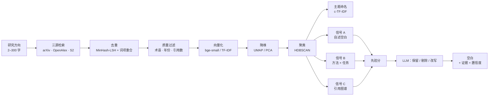

<p align="center">
  
</p>

<h1 align="center">空白侦察 · GapScout</h1>

<p align="center">
  <b>从真实文献里把研究空白算出来，而不是让大模型替你想象。</b>
</p>

<p align="center">
  <a href="https://github.com/loveBatman/gapscout/actions/workflows/ci.yml"></a>
  <a href="LICENSE"></a>
  
  
  
</p>

<p align="center">
  <a href="#快速开始"><b>快速开始</b></a> ·
  <a href="#工作原理">工作原理</a> ·
  <a href="#接口">接口</a> ·
  <a href="#已知限制">已知限制</a> ·
  <a href="README.md">English</a>
</p>

<p align="center">
  
</p>

- **算出来的，不是编出来的。** 三路独立信号必须同时指向同一处，才会被报告为空白；大模型只能保留或剔除候选，不能自己发明一个。
- **每一条引用都要过闸门。** 编号白名单 → 引用覆盖 → 逐句语义蕴含。校验跑不了的时候，结果会如实标成「未校验」，而不是假装通过。
- **在笔记本上就能跑，降级会说清楚。** 不要数据库、不要 API Key、不要 GPU；每一处降级都会写在返回结果里，绝不静默发生。

---

## 空白是算出来的，不是猜出来的

问通用大模型「这个领域有什么空白」，你会得到一段自信而流畅的回答，但指不回任何一篇文献。它面前没有语料，只能凭记忆重建一个听起来合理的答案；而无论对错，语气都一样笃定——这是最难察觉的一种失败。

空白侦察把顺序倒过来：先检索出一份真实语料，再在上面跑三路**互相独立**的信号。

| 信号 | 衡量什么 | 为什么不是「我没看到的关键词」 |
| --- | --- | --- |
| **A · 自述空白聚合** | 跨论文汇总作者明确写下的局限与 future work，叠加质心覆盖度——嵌入空间中「周围很密、这里很薄」的区域 | 依据是作者自己写下的话，并按证据质量加权，不是文本的缺失 |
| **B · 方法 × 任务矩阵** | 20 个方法族 × 15 个任务类型的矩阵，覆盖 6 个模态维度；邻域活跃、自身为空的单元格即是结构洞 | 两个维度交叉，空单元格是「没人发表过的组合」，而不是缺了一个词 |
| **C · 引用图谱** | 引用网络中的结构洞、新兴簇，以及潜在的转折点 | 用的是论文之间的引用关系，文本相似度看不到这一层 |

每一路各自给出先验分，且**分开呈现**，不揉成一个不透明的总分：

```
A:  篇数 × 证据权重 × (0.5 + gap_strength)
B:  log1p(邻域活跃度) × 1.6
C:  log1p(转折点潜力) × 1.1
```

直到这一步之后，大模型才看到候选。它只有三个动作：**保留、剔除、改写措辞**。它拿到的是证据与先验分，不能添加任何信号没有产出的空白。每一条被报告的空白，都带着它来自哪几篇论文。

这就是「生成一个空白」和「定位一个空白」的区别。

---

## 四项能力

四步，每一页相互独立：

**1 · 领域全景** —— 三源检索、去重、质量过滤、向量化、聚类、主题命名。得到一张能读的领域二维图、一份带代表论文的主题列表。

**2 · 空白识别** —— 跑上面三路信号，产出候选，再做批判性过滤。留下来的候选各自带着证据、置信度与新颖度。

**3 · 可行性评估** —— 用自然语言写一个想法，向量化后与语料比对，给出新颖度与撞车风险，并把最相近的已有工作并排列出来。

**4 · 综述生成** —— 在检索到的语料上生成分节综述。每一句都要过引用白名单；无法被支撑的句子会被标出来，而不是被润色掉。支持 Markdown 与 BibTeX 导出。

---

## 有测量，才有结论

下面这些是开发过程中实测的数字，保留它们是因为它们解释了设计决策，而不是为了宣称性能。可以用 `scripts/profile_run.py` 在你自己的语料上复现。

| 观察 | 实测 | 因此改了什么 |
| --- | --- | --- |
| 281 篇语料上首次调用 UMAP | 墙钟 22.7s，其中真正的降维只占 1.01s | 降维器只创建一次并复用；其余是一次性的 JIT 编译，不是每次运行的成本 |
| 直接在原始嵌入上跑 HDBSCAN | 163 篇里 132 篇被判为噪声，只出 1 个主题 | 降维是必需项而非可选项，缺了聚类会直接塌掉 |
| 嵌入模型被各阶段重复初始化 | 每次重载 10.1s | 模型改为进程内缓存 |
| 用中文整句检索 OpenAlex | 只召回 1 篇；改写成关键词形态后正常 | 查询在派发前先做改写，而不是原样传下去 |
| `bge-small` 余弦相似度 | 相关对 0.62–0.70，弱相关对 0.45–0.55 | 去重阈值定在 0.78 并叠加词项重合条件，而不是贴着相似度边界切 |
| 单次 LLM 批判 | 24.7–48.1s，占空白链路的 33%–40% | 这是一处最大开销；因此做成批量、有边界的调用，而不是逐条调用 |

这里**没有**与商业产品对标的跑分表。可信的对比需要共同任务和标注答案，本仓库没有提供，任何这样的表格都会变成宣传材料。

---

## 界面

| 空白识别 | 可行性评估 |
| --- | --- |
|  |  |

| 综述生成 | 入口 |
| --- | --- |
|  |  |

---

## 工作原理



**去重**用 MinHash-LSH：3-shingle、相似度阈值 0.78、64 个排列，把约 4×10⁶ 次朴素两两比较压到接近线性的候选集。只靠相似度会过度合并同一子领域的论文，所以必须叠加词项精确重合作为第二条件。

**聚类**故意用两套投影：5 维给 HDBSCAN，2 维给人看。用展示用的那套投影去聚类，就会出现上表里的噪声爆炸。

**进度**走 SSE。任务总线为每个任务维护独立队列、15 秒心跳，断线重连时补发当前状态，且不需要 Redis——因为这个项目的前提就是没有外部依赖也能跑起来。

---

## 快速开始

需要 **Python 3.11+** 与 **Node 18+**。不配数据库、不配 GPU、不配 API Key 也能把链路跑通。

```bash
git clone https://github.com/loveBatman/gapscout.git
cd gapscout
```

**1 · 后端**

```bash
cd backend
python -m venv .venv
source .venv/bin/activate        # macOS / Linux
# .venv\Scripts\activate         # Windows

pip install -e ".[embed,cluster]"
cp .env.example .env             # 然后在 .env 里填 DEEPSEEK_API_KEY
uvicorn app.main:app --reload --port 8001
```

`.[embed,cluster]` 会装上 `sentence-transformers` 与 `umap-learn`。不装这两组，服务同样能启动，但会静默降级到 TF-IDF 与 PCA——结果会有差异，想要预期效果就把它们装上。

**2 · 前端**（另开一个终端）

```bash
cd frontend
npm install
npm run dev
```

打开 <http://localhost:5173>。演示门禁账号是 **`root` / `123456`**——把它部署到任何公开位置之前，请先读[已知限制](#已知限制)。

**3 · 可选的数据库**

```bash
docker compose up -d            # pgvector，端口 5433
```

Postgres **不在关键链路上**。有它，结果按任务落库；没有它，同样的结果写成本地 JSON 快照。`/api/v1/health` 会告诉你当前是哪种模式。

### 验证安装

```bash
curl http://localhost:8001/api/v1/health
# {"status":"ok","app":"空白侦察 GapScout","version":"0.1.0",
#  "database":"down","llm_configured":true}
```

`database: "down"` 和 `llm_configured: false` 都是**正常可用状态**——它们告诉你当前启用了哪些降级，而不是哪里坏了。

### 网络受限时

嵌入模型首次运行会从 Hugging Face 下载。如果这个地址在你的网络里不通，在 `.env` 里把 `HF_ENDPOINT` 指向镜像（例如 `https://hf-mirror.com`）后重启后端。

---

## 配置

所有配置都有可用默认值。下面这些是真正需要知道的，其余在 `backend/.env.example` 里逐项写了注释。

| 变量 | 默认值 | 说明 |
| --- | --- | --- |
| `DEEPSEEK_API_KEY` | *(空)* | 留空即纯规则模式：没有批判，主题名也保持启发式 |
| `DEEPSEEK_BASE_URL` | `https://api.deepseek.com/v1` | 任何兼容 OpenAI 协议的端点都可以 |
| `LLM_MODEL_MAIN` | `deepseek-reasoner` | 只用于价值批判环节 |
| `LLM_MODEL_CHEAP` | `deepseek-chat` | 主题命名、查询改写 |
| `EMBED_MODEL` | `BAAI/bge-small-en-v1.5` | 换模型需同步修改 `app/config.py` 的 `EMBED_DIM` |
| `CONTACT_EMAIL` | `your_email@example.com` | 会写进 User-Agent；arXiv 与 OpenAlex 对可识别客户端给礼貌池限流 |
| `DATABASE_URL` | `postgresql+asyncpg://…:5433/gapscout` | 与 `docker-compose.yml` 一致，可选 |

---

## 接口

全部在 `/api/v1` 下。长任务都是异步的：POST 返回任务号，进度从任务端点流式推送。

| 方法 | 路径 | 请求体 | 用途 |
| --- | --- | --- | --- |
| `POST` | `/explore` | `{"direction": "…", "year_from": 2019, "min_citations": 0}` | 领域全景 |
| `POST` | `/gaps` | `{"direction": "…"}` | 空白识别 |
| `POST` | `/feasibility` | `{"idea": "…"}` | 新颖度与撞车风险 |
| `POST` | `/review` | `{"direction": "…"}` | 分节综述 |
| `GET` | `/tasks?limit=20` | — | 最近任务 |
| `GET` | `/tasks/{task_id}` | — | 单个任务的完整结果 |
| `GET` | `/tasks/{task_id}/stream` | — | SSE 进度，15 秒心跳 |
| `GET` | `/health` | — | 状态与当前降级情况 |

```bash
curl -X POST http://localhost:8001/api/v1/gaps \
  -H 'Content-Type: application/json' \
  -d '{"direction": "长上下文检索的高效微调"}'
# {"task_id":"…","status":"pending"}

curl -N http://localhost:8001/api/v1/tasks/<task_id>/stream
```

---

## 降级矩阵

五条互相独立的轴，每条都有兜底，且每条兜底都会写进输出——所以 `health` 里出现 `database: "down"` 是正常值，不是故障。

| 轴 | 缺失时 | 降级到 | 怎么看出来 |
| --- | --- | --- | --- |
| 数据库 | Postgres 未启动 | 进程内 JSON 快照 | `health.database == "down"` |
| 大模型 | 无 API Key 或接口不可达 | 纯规则打分；主题名保持启发式 | `health.llm_configured == false`、`semantic_check_skipped: true` |
| 嵌入 | 无 API Key 且无本地模型 | TF-IDF + SVD | 主题一致性下降；去重主要靠词项重合 |
| UMAP | 未安装 `umap-learn` | PCA 降到 20 维 | 簇更粗，散点图更噪 |
| 全文 | 付费墙或抓取失败 | HTML → PDF → 摘要 | 证据权重 `1.0` / `0.75` / `0.35` |

这些降级当然不如完整链路，这里不打算辩解。真正的重点是：**你永远能知道眼前这份结果是哪条路径产出的。**

---

## 与其它方案的区别

| | **空白侦察** | 直接问大模型 | 文献地图类工具 |
| --- | --- | --- | --- |
| 「空白」从哪来 | 在你实际检索到的语料上算三路信号，且必须互相印证 | 模型自己的记忆 | 不提供 |
| 引用处理 | 编号白名单 → 覆盖检查 → 逐句语义蕴含；失败会标注 | 给链接，但不逐句核验 | 指向真实论文 |
| 大模型的角色 | 只做保留 / 剔除 / 改写，不能新增空白 | 全部由它生成 | 查询扩展 |
| 无数据库、无 Key、无 GPU 可用 | 可以，且每处降级都有标注 | 不行 | 不行 |
| 可本地运行 | 可以 | 不行 | 不行 |
| 源码可得 | MIT | 无 | 无 |

第三列描述的是撰写时各产品公开文档所呈现的能力，这一类别变化很快。

---

## 目录结构

```
gapscout/
├── backend/
│   ├── app/
│   │   ├── api/v1/          # explore · gaps · feasibility · review · tasks · health
│   │   ├── agents/          # LLM 调用、价值批判、主题命名、引用校验
│   │   ├── pipeline/        # 去重 · 过滤 · 向量化 · 聚类 · 方法任务矩阵 · 图谱 · 自述空白
│   │   ├── sources/         # arXiv · OpenAlex · Semantic Scholar · 全文抓取
│   │   ├── services/        # 各业务链路编排 + 任务总线
│   │   ├── schemas/         # pydantic 请求/响应模型
│   │   └── config.py        # 全部配置的唯一来源
│   ├── data/eval_set.json   # 10 个方向及必须命中的论文
│   ├── scripts/             # 自检与测量脚本
│   └── pyproject.toml
├── frontend/
│   └── src/
│       ├── pages/           # 工作台 · 机会点 · 可行性 · 综述 · 登录
│       ├── components/      # 图表、时间线、空白卡片、基础组件
│       └── lib/             # SSE 客户端、任务执行器、接口封装
├── docs/images/             # 截图与 logo
└── docker-compose.yml       # 仅 pgvector，可选
```

---

## 自检脚本

`backend/scripts/` 里的脚本之所以存在，是因为「感觉很慢」和「聚类看着不太对」都不是测量。请在 `backend/` 下、激活虚拟环境后运行。

| 脚本 | 验证什么 | 需要网络 | 需要大模型 |
| --- | --- | --- | --- |
| `check_stage_contract.py` | 后端推送的每个阶段都在前端序列中有定义 | 否 | 否 |
| `check_sources.py` | 三源连通；各阶段去重与过滤后的计数 | 是 | 否 |
| `analyze.py` | 检索 → 去重 → 过滤 → 向量化 → 聚类，端到端 | 是 | 否 |
| `probe_queries.py` | 各数据源能接受的查询构造形式 | 是 | 否 |
| `check_gaps.py` | 空白链路，并实时打印三路信号的产出 | 是 | 是 |
| `check_feasibility.py` | 单个想法的新颖度与撞车评分 | 是 | 是 |
| `check_review.py` | 综述生成与引用契约校验 | 是 | 是 |
| `profile_run.py` | 各阶段耗时与 LLM 开销 | 是 | 是 |
| `run_eval.py` | 对 `eval_set.json` 中必须命中论文的召回 | 是 | 是 |
| `compare_models.py` | 同一输入在两个模型档位下的对比 | 是 | 是 |

CI 跑的是 `check_stage_contract.py`：它只做静态分析，不会因为网络或额度而随机失败。

---

## 已知限制

这些不是伪装成路线图的待办，而是当前真实存在的、有意的取舍。

1. **界面以中文为先。** 所有页面、标签与报错都是中文，没有 i18n 层；英文 README 是唯一的英文界面。双语支持在路线图上，不在代码里。
2. **登录页是演示门禁，不是鉴权。** 账号密码以明文打包进前端产物（`frontend/src/lib/accounts.ts`），后端没有任何鉴权层——每个接口都是开放的。它只用来挡住无意访问的人。**请不要把它的实例暴露到公网。**
3. **没有一键部署。** `docker-compose.yml` 只有一个 `db` 服务，仓库里没有 Dockerfile；前后端需要按上面的步骤分别启动。任何「一键打包」的说法，`clone` 一次就站不住。
4. **还没有单元测试。** CI 目前跑阶段契约检查、lint 与前端构建，这些能拦住真实回归；但链路逻辑本身只由上面那些自检脚本覆盖，而它们需要网络和 API Key，不适合挂在每次 PR 上。

---

## 路线图

- 双语界面（中／英），把写死的文案抽出来
- 服务端鉴权与按用户隔离的工作区
- Dockerfile，以及能把三个服务一起拉起来的 compose profile
- 为纯函数（去重、过滤、先验打分）补单元测试，让 CI 能覆盖逻辑而不只是契约
- 空白报告导出为独立文档

---

## 参与贡献

欢迎提 Issue 与 PR。动工前有几点值得知道：

- 这是 **alpha**——接口与打分常数仍在变动，大改动前先开 Issue 对齐。
- 改后端请先在 `backend/` 下跑 `ruff check app` 与 `check_stage_contract.py`，CI 两个都跑。
- 如果你改了后端推送的阶段值，记得同步 `frontend/src/types/index.ts` 里的前端序列——契约检查守的正是这一条。

---

## 数据来源

检索建立在 **[arXiv](https://arxiv.org)**、**[OpenAlex](https://openalex.org)** 与 **[Semantic Scholar](https://www.semanticscholar.org)** 之上。请遵守各自的使用条款与限流约定；配置 `CONTACT_EMAIL` 可以让你的请求被识别、进入礼貌池。全文优先抓取 arXiv HTML，取不到时依次降级到 PDF 与摘要。

本项目与上述服务没有隶属关系。

---

## 许可证

[MIT](LICENSE) © 2026 loveBatman

## 引用

如果它在你的成果里起了作用，给一个反向链接就够了：

```bibtex
@software{gapscout,
  title  = {GapScout: compute research gaps from real literature},
  author = {loveBatman},
  year   = {2026},
  url    = {https://github.com/loveBatman/gapscout},
  note   = {MIT licensed}
}
```
